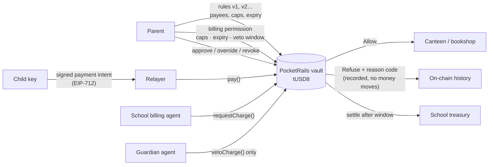
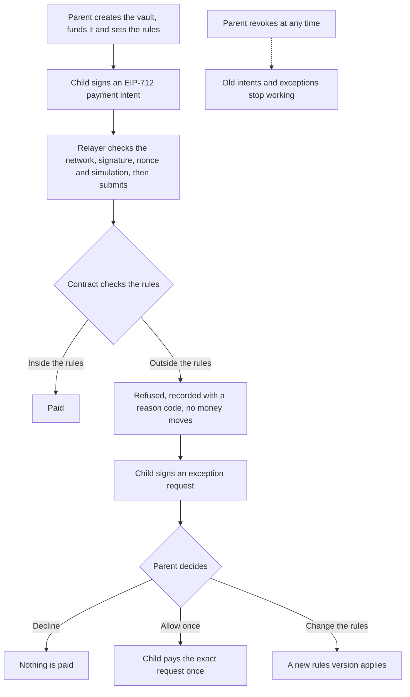
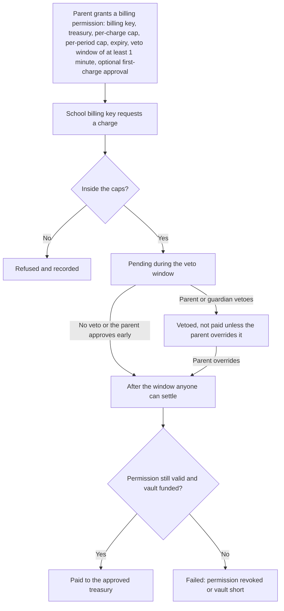

# Pocket Rails

**Kids pay out, the school bills in, parents set the rules once.**
Every payment, in either direction, is checked by the same smart contract on QDay Aevum testnet, in tUSD8.
AI helpers can say no, never yes: every yes traces back to a permission the parent signed.

A parent wants to give a child spending money without approving every payment or handing over a card with no
limits. The child's school also needs to collect money for meals and trips from that same allowance. Pocket
Rails keeps the money in a smart contract that checks every payment in both directions: the child pays inside
rules the parent set, the school bills under a permission the parent granted, and a guardian, which can be an
AI agent, can stop a school charge but never approve one. It runs on Aevum testnet with test tokens only and
is not audited.

| Try it | |
|---|---|
| **Live app** | _hosted URL coming soon_ (runs locally today: see [Run it locally](#run-it-locally)) |
| **Contract** | [`0x7d54…40Df` on the Aevum explorer](https://explorer-test.qday.info/address/0x7d54567d9D40641907B76A6b2fe6cb046e2B40Df) (source verified) |
| **Live runs** | [docs/DEMO_RUN.md](docs/DEMO_RUN.md): every step of the child and school flows, with transaction links |
| **Demo accounts** | [docs/TESTNET_ACCOUNTS.md](docs/TESTNET_ACCOUNTS.md) |

## What makes Pocket Rails different

1. **The school pulls charges under a veto window.** The parent grants the school a capped, expiring billing
   permission. Each charge waits as Pending for at least one minute, the parent or the guardian can veto it
   in that time, and after the window anyone can settle it.
   Code: [`requestCharge`](contracts/src/PocketRails.sol#L585), [`vetoCharge`](contracts/src/PocketRails.sol#L624), [`settle`](contracts/src/PocketRails.sol#L662).
   Tests: [`test_charge_settlesAfterVetoWindow`](contracts/test/PocketRailsBilling.t.sol#L47), [`test_vetoOnlyInsideWindow`](contracts/test/PocketRailsBilling.t.sol#L128),
   [`test_revokeBilling_pendingChargesFail`](contracts/test/PocketRailsBilling.t.sol#L218).
2. **A guardian that can only veto.** The guardian key's one special power is `vetoCharge`: it can't approve,
   raise a limit or move money, and the parent can override a wrongful veto. The guardian agent's AI review
   treats charge notes as untrusted data and answers "unknown" when unsure, which leaves the charge for the
   parent.
   Code: [`agents/`](agents/), [`agents/src/review.ts`](agents/src/review.ts).
   Tests: [`agents/src/policy.test.ts`](agents/src/policy.test.ts), [`test_guardianCanNeverApprove`](contracts/test/PocketRailsBilling.t.sol#L160),
   [`test_parentOverridesWrongVeto`](contracts/test/PocketRailsBilling.t.sol#L168).
3. **Refusals are recorded, not reverted.** A refused payment or charge still succeeds as a transaction, moves
   no money and records a reason code, so every refusal has a transaction hash anyone can check.
   See: [Reason codes](#reason-codes). Tests: [`test_refuse_payeeNotApproved`](contracts/test/PocketRails.t.sol#L105),
   [`test_refuse_overPerPaymentLimit`](contracts/test/PocketRails.t.sol#L109), [`test_charge_overPerChargeCap_refused`](contracts/test/PocketRailsBilling.t.sol#L78).
4. **Built for a real family situation.** The child sees a plain explanation and a next step when something is
   refused, and doesn't pay gas because a relayer submits their signed payments. In the business model the
   school is the paying customer (a hypothesis we haven't validated).
   See: [child screen](web/src/app/child/page.tsx), [plain-language messages](packages/pocket-rails/src/reasons.ts),
   [Business model and distribution](#business-model-and-distribution).

## See it in 60 seconds

1. **A school charge goes Pending.** The school agent's meal charge waits out the veto window before it
   settles: [charge #3](https://explorer-test.qday.info/tx/0xedb7b0bb001b823a05cb344eafd32f95809966dc2298a437faa59b38ea272ff1).
2. **The guardian vetoes a duplicate.** Run the school agent with `DEMO_SCENARIO=duplicate`
   ([scenario](agents/src/school-biller.ts#L66)). The guardian veto recorded on Aevum so far is a different
   scenario, a note that tries to instruct the AI review:
   [charge](https://explorer-test.qday.info/tx/0x12eb091a5b8db16324899627603553b156d1373cb78ba70b6ca9b864f7d258da),
   [veto](https://explorer-test.qday.info/tx/0x779643d86942280890ae0f78d572a48f8cb973ef37bb37ebe5f3a103093607bf).
3. **The parent overrides a wrong veto.** `approveCharge` on a vetoed charge pays it now
   ([test_parentOverridesWrongVeto](contracts/test/PocketRailsBilling.t.sol#L168)). The parent screen doesn't offer this yet.
4. **An over-cap charge is refused and recorded.** Run the school agent with `DEMO_SCENARIO=overcap`
   ([scenario](agents/src/school-biller.ts#L77), [test](contracts/test/PocketRailsBilling.t.sol#L78)).
5. **The child's refused payment shows a plain explanation.** "This is more than you can spend in one
   payment.": [refusal](https://explorer-test.qday.info/tx/0xb5a88dad7b25a785382590b3275140d85aee0e5f7bc09c207af3e20901870296).
6. **The parent revokes, and the next payment is refused and recorded.**
   [revoke](https://explorer-test.qday.info/tx/0x3468f32fb67e8559d66693bfb78c1178e7e145a595d775351b8e1492419a06d2),
   [refused payment](https://explorer-test.qday.info/tx/0xd8ccd222a21a483290514b26c92d24c55a9b90515d0491bb5aab873fdb0079d2).

Every step of both live runs: [docs/DEMO_RUN.md](docs/DEMO_RUN.md).

## Shared building blocks

The child side uses familiar spending controls: [approved places, a per-payment limit, a weekly limit and an
expiry date](#child-pays-push), [one-time exceptions](#one-time-exceptions), [instant revocation](#what-revoking-does-to-things-already-in-flight)
and [gasless signed intents submitted by a relayer](#relayer-api). The full list of threats and controls is in
the [Safety model](#safety-model).

> Built for Aevum Builder Challenge #1. **Testnet only, test tokens only, not audited.** No real money,
> no real children's data and no real merchants. It doesn't replace parental judgment.

---

## Status

| Part | State |
|---|---|
| `PocketRails.sol`: vaults, versioned rules, child payments, recorded refusals, one-time exceptions, school billing with veto window, revocation | Done: 57 unit and fuzz tests, 3 invariants (128,000 random calls), 2 fork tests on the real tUSD8 |
| TypeScript SDK (`packages/pocket-rails`): ABI, EIP-712 intents, reason codes, outcome decoding | Done |
| Relayer for child intents (`/api/rails/relay`) and outcome lookup (`/api/rails/tx`) | Done, tested end to end on a local chain (`pnpm example demo-flow`) |
| Deployment to Aevum testnet | Done and **source verified** on the explorer: `0x7d54567d9D40641907B76A6b2fe6cb046e2B40Df` |
| Screens: home, parent, child (phone-first), school, guardian | Done (`web/src/app`) |
| History cache for the on-chain timeline (`/api/rails/events`) | Done |
| Guardian agent and school billing agent (`agents/`) | Done, run live on Aevum with AI review ([docs/DEMO_RUN.md](docs/DEMO_RUN.md)) |
| Hosted demo | To do |

---

## The problem

Parents of school-age children usually choose between approving every payment (slow for both sides) and
handing over a card or cash with no limits (overspending, scams, money going to the wrong place). Schools,
meanwhile, chase fees for meals, transport and trips.

Pocket Rails sits in between: real limits, real independence, and predictable school billing. The rules
live in the contract that holds the money, so the app's screens can't be bypassed.

**Target users (hypotheses we haven't validated):** parents of secondary-school students who give daily
money for lunch, transport and school items, including parents who fund a child's school costs from another
country, and schools that want pre-approved, capped fee collection.

## How it works



**Child pays (push), step by step**



The parent creates the vault, funds it with tUSD8 and sets the rules. The child signs an EIP-712 payment
intent, and the relayer checks the network, the signature, the nonce and a simulation before submitting it.
The contract then checks the rules: inside them, the payment is made; outside them, it is refused, recorded
with a reason code, and no money moves. For something outside the rules, the child signs an exception
request, and the parent can decline it, allow it once, or change the rules. An allowed exception covers only
that exact request, once. The parent can revoke the child's access at any time, which ends all older intents
and exceptions.

**School bills (pull), step by step**



The parent grants a billing permission with a billing key, a treasury address, a per-charge cap, a
per-period cap, an expiry date, a veto window of at least 1 minute and, optionally, approval of the first
charge. The school's billing key then requests a charge. Inside the caps, the charge is pending; outside them,
it is refused and recorded. During the veto window the parent or the guardian can veto the charge. The parent
can also approve it early or override a veto, but the guardian can never approve. After the window anyone can
settle the charge: it is paid to the approved treasury, or it fails if the permission was revoked or the
vault doesn't hold enough.

### Child pays (push)

1. The parent creates a vault, funds it with tUSD8 and sets rules: approved payees, a per-payment limit,
   a weekly limit (weeks start Monday 00:00 UTC) and an access expiry date.
2. The child signs a payment intent. A relayer submits it, so the child never needs gas.
3. Inside the rules, it's paid with no approval. Outside, the transaction still succeeds but moves no money
   and records `Refused` with a reason code, so a refusal has a transaction hash too.

### One-time exceptions

1. The child signs a request for a specific payee, amount and note.
2. The parent declines, allows it once (with an expiry), or changes the standing rules.
3. An allowed exception covers only that exact payee, amount and note hash, works once, and never changes
   the standing rules or uses the weekly allowance.

### School bills (pull)

1. The parent grants the school a billing permission: a billing key, a treasury address, a per-charge cap,
   a per-period cap, an expiry and a veto window (minimum 1 minute). Optionally, the first charge needs the
   parent's approval.
2. The school's billing key requests a charge. Inside the caps it becomes **Pending**; outside, it's
   recorded as refused.
3. During the veto window the parent or the guardian can veto. After it, anyone can settle.
4. The parent can approve early, or override a wrong veto. The guardian can never approve.

### The four outcomes

| Outcome | Where it lives | Meaning |
|---|---|---|
| Allow | On-chain (`Paid`, `ChargeSettled`) | Inside the rules, paid |
| Refuse | On-chain (`Refused`, `ChargeRefused`, `ChargeFailed`) | A rule was broken; reason code recorded |
| Pending | On-chain (exception `Pending`, charge `Pending` / `AwaitingParent`) | Waiting for a parent decision or the veto window |
| Unknown | **Off-chain only** (app and agents) | Something couldn't be verified (RPC failure, unconfirmed transaction, ambiguous request), so nothing is submitted |

### Reason codes

| Code | Name | Plain language shown to users |
|---|---|---|
| 1 | AccessRevoked | Your parent has paused your spending. |
| 2 | AccessExpired | Your spending access has ended. Ask your parent to renew it. |
| 3 | PayeeNotApproved | This place isn't on your approved list. You can ask for an exception. |
| 4 | OverPaymentLimit | This is more than you can spend in one payment. |
| 5 | OverWeeklyLimit | This would take you over your weekly limit. |
| 6 | InsufficientBalance | There isn't enough money in your allowance. |
| 7 | ExceptionNotApproved | That exception isn't approved, has expired, or was already used. |
| 8 | ExceptionMismatch | This payment doesn't match the exception your parent approved. |
| 9 | OverChargeLimit | The school asked for more than one charge is allowed to be. |
| 10 | OverPeriodLimit | The school has reached this period's billing limit. |
| 11 | BillingExpired | This billing permission has ended. |
| 12 | BillingRevoked | The parent has cancelled this billing permission. |

---

## The app

| Page | Who | What they can do |
|---|---|---|
| `/` | Everyone | What Pocket Rails is, the four roles, live counts from the contract |
| `/parent` | Parent | Open a vault (pre-filled in demo mode), top up and withdraw, edit rules (each save is a new version), approve or remove places, allow-once or decline requests, approve or veto school charges, grant and revoke school billing, set the guardian, pause or revoke everything, read the full on-chain history |
| `/child` | Child (phone-first) | See balance and what's left this week, pay an approved place with a live rules check before signing, see plain-language refusals with a next step, ask for an exception, pay an allowed exception, see activity. Never needs gas. |
| `/school` | School billing key | Send charges inside the caps, watch the veto window, settle when it's over |
| `/guardian` | Guardian key | Veto open school charges with a reason. Nothing else. |

Current state (balances, rules, requests, charges) is read straight from the contract. The timeline comes
from `/api/rails/events`, a small server-side cache: Aevum makes about 85,000 blocks a day and `eth_getLogs`
covers at most 1,000 blocks per call, so it scans in parallel once, saves to `web/.cache/`, then only reads
new blocks.

## Agents

Two small Node agents in `agents/`, each with its own TEST key. Neither can exceed what the contract allows.

| Agent | Run | What it does | What it can't do |
|---|---|---|---|
| School billing | `pnpm --filter agents school` | Bills one meal per school day (or every N seconds in demos) on every live permission granted to its key, skipping weekends and staying inside the caps. Never bills the same slot twice: it checks the chain for a charge with the same note first, so restarts are safe. Settles charges once their veto window ends. | Charge more than the caps, shorten the veto window, or pay anyone but the treasury the parent approved |
| Guardian | `pnpm --filter agents guardian` | Watches every vault that names its key as guardian. Each open charge goes through rules (duplicate note, weekend, price over 1.5× the usual), then optionally an AI review of the note (`AI_REVIEW=1`, Claude `claude-opus-5-5` with structured output limited to `veto` / `no_action` / `unknown`). Vetoes inside the window with a reason; "unknown" means it leaves the charge and reports it. | Approve, raise a limit, or move money: `vetoCharge` is the only thing its key may call |

The AI review treats the note as untrusted data: instructions inside a note are themselves a reason to veto.
A refusal, an API error or an unreadable answer becomes "unknown", never a guess.

Charge notes live off-chain. The contract stores only `keccak256(note)`; the school agent publishes the text
to `/api/rails/notes`, which accepts it only if its hash matches, so nobody can attach different text to a
charge. Children's notes are never sent there.

Demo scenarios (`DEMO_SCENARIO`, sent once after the normal meal): `duplicate` (guardian vetoes),
`overprice` (guardian vetoes), `trick` (a note that tries to instruct the AI review), `overcap` (the
contract refuses and records it). Settings: `agents/.env.example`. Rule tests: `pnpm --filter agents test`.

## Safety model

| Threat | What stops it |
|---|---|
| Child's key is stolen | It can only pay approved payees inside the caps, or request exceptions. The parent revokes it instantly. |
| A relayer changes a payment | Intents are EIP-712 signatures over vault, payee, amount, memo, exception, nonce, epoch and deadline, bound to chain ID and contract address. Any change fails the signature check. |
| Replaying a payment or exception | Nonces are single-use (refused intents use them up too). Exceptions are single-use. |
| Old signed intents after a revoke | Revoking bumps an epoch; intents and exceptions from older epochs are refused. |
| School billing key is stolen | Charges are capped per charge and per period, wait out a veto window, and settle only to the treasury address the parent approved. |
| School overcharges or double-charges | The guardian agent or parent vetoes inside the window. |
| Guardian agent is fooled (prompt injection) or wrong | It can only veto. It can't approve, raise a limit or move money. The worst case is a wrongful veto, which the parent can override. |
| Guardian agent is offline | Charges inside the caps still settle after the window, like a bank direct debit. Use the first-charge approval and tight caps; a "hold all if the guardian is offline" setting is on the roadmap. |
| Admin abuse | There is no admin, owner or upgrade path. Only a vault's parent can change that vault. |
| Parent key is stolen | Out of scope for the contract: the parent key is the root of authority. Roadmap: parent as a smart account with recovery. |
| Privacy | Memos are stored as hashes only. Payees and amounts are public on any public chain; don't put personal details in labels. |

"Every yes traces back to a permission the parent signed": a child's payment is allowed by rules the parent
set, an exception by the parent's `allowOnce`, and a school charge by the billing permission the parent
granted. School charges inside that permission settle after the veto window without a fresh signature, the
same way a direct debit works.

### What revoking does to things already in flight

| Situation | Result | Test |
|---|---|---|
| Parent revokes a billing permission while a charge is pending | The charge can't be paid. `settle()` marks it `Failed` (reason `BillingRevoked`) and frees its allowance; new charges are refused. | `test_revokeBilling_pendingChargesFail` |
| Parent calls `revokeAll` | Child access off, every billing permission and pending charge dead, pending exceptions dead. Funds stay in the vault. | `test_revokeAll_stopsEverything` |
| Parent revokes, then clicks Approve on an old charge | Still not paid: the charge fails. A revoked permission can't be revived by approving. | `test_approveAfterRevoke_cannotPay` |
| Child access revoked (or rotated) with signed intents not yet submitted | Refused and recorded (`AccessRevoked`); exceptions from before the revoke can't be used. | `test_refuse_afterRevoke_andOldIntentsStayDeadAfterRestore`, `test_exception_diesOnRevoke` |
| A permission **expires** while a charge is in its window | The charge can still settle (it was requested while the permission was valid); new charges are refused. | `test_charge_afterExpiry_refused` |
| Vault doesn't hold enough when the window ends | `Failed` (`InsufficientBalance`), nothing moves, the allowance is freed. | `test_settle_insufficientBalance_fails` |

---

## How Pocket Rails uses Aevum

| Aevum piece | How it's used | Where |
|---|---|---|
| **tUSD8** (`0x4565…3483`, 6 decimals) | The only currency. Vault balances are tracked inside PocketRails and backed 1:1 by tUSD8 it holds (checked by an invariant test over 128,000 random calls). | `contracts/src/PocketRails.sol`, `PocketRailsInvariant.t.sol` |
| **EIP-3009 `receiveWithAuthorization`** on tUSD8 | Gasless top-ups: anyone signs a transfer to PocketRails and anyone submits it. The authorization nonce is `keccak256(contract, vaultId, salt)`, so a relayer can't credit a different vault. Tested against the real tUSD8 on a fork. | `depositWithAuthorization`, `test/fork/PocketRailsFork.t.sol` |
| **EIP-712 signatures on chain 44005** | Children sign payment intents and exception requests; the domain binds them to chain 44005 and this contract. `SignatureChecker` also accepts ERC-1271 smart-account signatures. | `hashPayment`, `packages/pocket-rails/src/intents.ts` |
| **Shanghai EVM** (no Cancun opcodes) | Compiled with `evm_version = "shanghai"`; `make build` scans the bytecode for Cancun-only opcodes; no transient-storage OpenZeppelin contracts. | `contracts/foundry.toml`, `tools/check-shanghai.mjs` |
| **Legacy (type 0) transactions** | The relayer, agents and app send legacy transactions, as Aevum recommends. | `web/src/app/api/rails/relay/route.ts`, `agents/src/lib.ts` |
| **`eth_getLogs` limited to 1,000 blocks; ~1 block/second** | History is scanned server-side in parallel 1,000-block chunks, cached to disk, then read incrementally. Current state never depends on logs: it's read from contract views. | `web/src/lib/indexer.ts` |
| **No WebSocket RPC** | The app and agents poll over HTTPS (transaction status every 1.5 s, state every few seconds). | `web/src/app/api/rails/tx/route.ts`, `agents/` |
| **Multicall3** | Lists (allowances, requests, charges) are read in one call each. Agents fall back to single reads on chains without it. | `web/src/lib/rails.ts`, `agents/src/lib.ts` |
| **Explorer (Blockscout)** | Source verified; every screen and log links transactions to it. | [contract page](https://explorer-test.qday.info/address/0x7d54567d9D40641907B76A6b2fe6cb046e2B40Df?tab=contract) |
| **Starter kit** (`qday-io/aevum-starter-kit`) | Foundry setup, `MockUSD8`, Shanghai check, chunked log helper, chain config, Next.js scaffolding, relayer protections. Credited in `NOTICE.md`. | `packages/aevum`, `tools/` |
| **Faucets** | Demo accounts were funded from the Discord faucet (the web faucet requires mainnet holdings); demo amounts are scaled to one claim. | `docs/PLATFORM_FEEDBACK.md` |
| **ERC-4337 EntryPoint v0.7 and Kernel v3.1** | Not used yet (see the note below the table) | Roadmap |
| **ERC-8004 identity registry** | **Not used.** The starter kit says QDay's registry isn't open for this challenge, so approved places are stored in PocketRails. | Roadmap |

### Why no smart account or session key yet

On 18 Nov 2026, PQA-Morris updated the challenge's official starter kit with the commit "Docs: account
abstraction is not required and not supported" ([`f7bc531`](https://github.com/qday-io/aevum-starter-kit/commit/f7bc531)).
Its FAQ says account abstraction isn't required for this challenge, that there is no officially supported
bundler or paymaster, that gasless payments can use EIP-3009 with a relayer, and that budgets, limits, expiry
and revoke should be written into your own contract. Pocket Rails follows that guidance: gasless top-ups use
EIP-3009, and the child's gasless payments use the same relayer pattern with signed EIP-712 intents. The
child's key is scoped by the contract: it can only pay approved places inside the caps or request exceptions,
and the parent can revoke it instantly. The contract already accepts ERC-1271 signatures, so moving the parent
or child to a Kernel smart account with session keys is a roadmap step, not a redesign.

## Business model and distribution

These are plans and hypotheses, not validated results.

- **Who pays: schools, not families.** A school gets pre-approved, capped collection for meals, transport and
  trips, with fewer unpaid balances and no cash handling. Hypothesis: a small fee per settled charge (for
  example 0.5–1%) or a flat monthly fee per school, with the family side free.
- **Optional family plan.** A hosted guardian (rules plus AI review) and multi-child dashboards as a small
  subscription; the core allowance stays free.
- **Distribution: school by school.** One school onboards its canteen and transport as approved places and
  its billing agent as a permission template; it then invites families, who open an allowance in minutes.
  Every school that joins brings its families, and families bring siblings at other schools.
- **First markets (hypothesis):** schools where stablecoin payments already make sense, such as cross-border
  families paying school costs and private or international schools.
- **Path to production:** licensed on- and off-ramp partners, an audit, the parent as a smart account with
  recovery, and Aevum mainnet once available. Real deployments with minors would need legal review in each
  market.

---

## Contracts

| Contract | Address (Aevum testnet, chain 44005) |
|---|---|
| PocketRails | [`0x7d54567d9D40641907B76A6b2fe6cb046e2B40Df`](https://explorer-test.qday.info/address/0x7d54567d9D40641907B76A6b2fe6cb046e2B40Df), deployed in block 4072059 by tx [`0xc77c22a4…b728`](https://explorer-test.qday.info/tx/0xc77c22a458fe2fc54d47085ccc195e5e496764174d01b502f03eeb9ffdabb728) |
| tUSD8 | [`0x456569838f1d43009A91ebA4263147Afd7233483`](https://explorer-test.qday.info/address/0x456569838f1d43009A91ebA4263147Afd7233483) |

**Source verified** on the Aevum explorer (Blockscout) on 2026-11-25: compiler 0.8.24, optimizer 200 runs,
EVM `shanghai`, 23 source files ([view the verified code](https://explorer-test.qday.info/address/0x7d54567d9D40641907B76A6b2fe6cb046e2B40Df?tab=contract)).
It was deployed from commit [`335f5e6`](https://github.com/datharnu/pocket-rails/tree/335f5e64b223e0ffcc10abab00407ea30c02d585); the contract
hasn't changed since. Reproduce the verification with:

```bash
cd contracts && forge verify-contract 0x7d54567d9D40641907B76A6b2fe6cb046e2B40Df src/PocketRails.sol:PocketRails \
  --chain-id 44005 --verifier blockscout --verifier-url https://explorer-test.qday.info/api/ \
  --constructor-args $(cast abi-encode "constructor(address)" 0x456569838f1d43009A91ebA4263147Afd7233483)
```
 A live run of the full flow, with every transaction: [docs/DEMO_RUN.md](docs/DEMO_RUN.md). Demo accounts and their roles:
[docs/TESTNET_ACCOUNTS.md](docs/TESTNET_ACCOUNTS.md).

### Main functions

| Who | Function |
|---|---|
| Parent | `createVault`, `setRules`, `setPayee`, `setChild`, `revokeChild`, `setGuardian`, `revokeAll`, `withdraw` |
| Parent | `allowOnce`, `declineException`, `grantBilling`, `revokeBilling`, `approveCharge` |
| Anyone | `deposit`, `depositWithAuthorization` (gasless EIP-3009 top-up), `settle` (after the veto window) |
| Child (signed, anyone submits) | `pay`, `requestException` |
| School billing key | `requestCharge` |
| Parent or guardian | `vetoCharge` |
| Views | `getVault`, `getException`, `getBilling`, `getCharge`, `previewPayment`, `spentThisWeek`, `hashPayment` |

---

## Run it locally

You need Node 22+, pnpm and [Foundry](https://book.getfoundry.sh/getting-started/installation).

```bash
git clone --recursive <this repo>
cd pocket-rails
make install          # Solidity libs + JS packages
make test             # unit, fuzz and invariant tests
make test-fork        # the flow against the real tUSD8 on a local fork of Aevum (no funds needed)
make build            # compile + check the bytecode is Shanghai-safe (Aevum has no Cancun opcodes)
```

If another program called `forge` comes first on your PATH, pass Foundry's: `make test FORGE=/opt/homebrew/bin/forge`.

### Deploy to Aevum testnet

1. Create two fresh TEST wallets: a deployer/parent and a relayer (`cast wallet new`). Never reuse a wallet
   that holds anything of value.
2. Fund both with tQDAY, and the parent with tUSD8, from [faucet.qday.info](https://faucet.qday.info/en)
   (or `/faucet` in the QDay Discord).
3. Deploy (the keystore keeps the deployer key encrypted):

```bash
cast wallet import deployer --interactive
make deploy-aevum ACCOUNT=deployer           # prints the PocketRails address; note the block number too
```

4. Put the address in `web/.env.local` (`NEXT_PUBLIC_NETWORKS=aevum`, `NEXT_PUBLIC_RAILS_AEVUM=…`) and the
   relayer key in `RELAYER_PRIVATE_KEY`, then add the address to the Contracts table above with a link to
   the exact commit, then verify the source on the explorer (see the Contracts section).

### Run the whole flow locally (no funds needed)

```bash
make anvil                                   # terminal 1: local Shanghai chain
make deploy-local                            # prints MockUSD8 and PocketRails addresses
# web/.env.local:  NEXT_PUBLIC_NETWORKS=local, NEXT_PUBLIC_RAILS_LOCAL=<address>,
#                  RELAYER_PRIVATE_KEY=<anvil account #1 key, allowed on local chains only>
pnpm dev                                     # terminal 2: web app + relayer on :3000
# examples/.env:   RPC_URL=http://127.0.0.1:8545, RAILS_ADDRESS=<address>, PARENT_KEY=<anvil account #0 key>
pnpm example demo-flow                       # terminal 3: parent + child through the real relayer
```

`demo-flow` runs: create and fund a vault → child pays (allowed) → child overspends (refused, recorded) →
exception requested → allowed once → wrong amount refused → exact amount paid → reuse refused → tampered
intent rejected by the relayer → replay rejected → access revoked → payment refused. Pointed at Aevum
testnet, it prints explorer links for every step.

### Environment variables

**web/.env.local** (see `web/.env.example`)

| Variable | Required | Meaning |
|---|---|---|
| `NEXT_PUBLIC_NETWORKS` | yes | `aevum`, `fork` or `local` (comma-separated; the first is the default) |
| `NEXT_PUBLIC_RAILS_AEVUM` / `_FORK` / `_LOCAL` | yes, for each network you use | PocketRails address |
| `NEXT_PUBLIC_RAILS_DEPLOY_BLOCK_AEVUM` / `_FORK` | recommended | Block PocketRails was deployed at; history is read from here |
| `RELAYER_PRIVATE_KEY` | for gasless child payments | A fresh TEST wallet with a little tQDAY. Server-only. anvil keys are refused on Aevum. |
| `RELAYER_REFUSALS_PER_VAULT_PER_HOUR` | no | Recorded refusals per vault per hour (default 10, `0` = no limit for demo rehearsals) |
| `RELAYER_DAILY_TX_LIMIT` | no | Max relayed transactions per day per server process (default 500) |
| `TRUSTED_IP_HEADER` | on a hosted deploy | Header your host sets with the client IP (Vercel: `x-vercel-forwarded-for`) |
| `NEXT_PUBLIC_WC_PROJECT_ID` | no | Enables WalletConnect for mobile wallets |
| `NEXT_PUBLIC_DEMO_CHILD` / `_SCHOOL` / `_GUARDIAN` | no | Demo mode: pre-fill the parent's forms with these addresses |
| `NEXT_PUBLIC_REPO_URL` | no | Where the "Source code" link points |

**examples/.env** (see `examples/.env.example`)

| Variable | Meaning |
|---|---|
| `RPC_URL` | `https://rpc-test.qday.info` for Aevum, `http://127.0.0.1:8545` for anvil |
| `RAILS_ADDRESS` | PocketRails address |
| `PARENT_KEY` | A TEST wallet with a little tQDAY and at least 2 tUSD8 per `demo-flow` run |
| `CHILD_KEY` | Optional. The child's TEST wallet (needs no funds). Default: a fresh key per run |
| `CANTEEN_ADDRESS` | Optional. The approved payee. Default: a fresh address per run |
| `APP_URL` | Where the web app runs (default `http://localhost:3000`) |

### Relayer API

`POST /api/rails/relay` submits a child's signed intent. The relayer can't change an intent (the signature
would break) and can't pay anything the contract's rules don't allow.

```json
{
  "chainId": 44005,
  "kind": "pay",
  "intent": { "vaultId": "1", "payee": "0x…", "amount": "3000000", "memoHash": "0x…", "exceptionId": "0",
              "nonce": "…", "epoch": "1", "deadline": "1795608300" },
  "signature": "0x…"
}
```

Response: `{ "hash": "0x…", "expected": { "reason": 0, "name": "None", "message": "Paid.", "nextStep": "" } }`.
`expected` comes from a simulation; the confirmed receipt is the truth. `kind` can also be
`requestException` (same fields without `exceptionId`).

Before spending gas it checks: the network and contract are yours, the intent is well formed with a deadline
at most 15 minutes ahead, the signature is the vault's child key (off-chain), the nonce is unused and not
in flight, and the simulation doesn't revert. It rate-limits per IP and per vault (only correctly signed
requests count toward a vault's limit), allows each vault at most 10 recorded refusals per hour, caps
transactions per day, and retries once if its own nonce is stale. These limits are in memory; use a shared
store (for example Redis) on serverless hosting.

`GET /api/rails/tx?hash=0x…&chainId=44005` returns `{ "state": "unknown" }` until the transaction is
confirmed, then `{ "state": "confirmed", "outcome": { "kind": "allow" | "refuse" | "pending" | "other" | "failed", "reason", "message", "events" } }`.
Aevum has no WebSocket RPC, so clients poll it.

---

## Known constraints

- Aevum runs the Shanghai EVM: no Cancun opcodes (checked by `make build`).
- `eth_getLogs` is limited to 1,000 blocks per call, so the app reads history in chunks.
- Weekly limits use fixed weeks starting Monday 00:00 UTC, not a rolling 7 days.
- Exceptions don't count toward the weekly limit. A parent's override of a vetoed charge counts toward the
  period's usage but isn't blocked by the cap (it's the parent's explicit decision).
- A charge settles to the treasury fixed in the permission. A permission that expires during a charge's veto
  window can still settle that charge.
- Refusals cost gas. The relayer records at most `RELAYER_REFUSALS_PER_VAULT_PER_HOUR` refusals per vault
  per hour (default 10; set `0` to turn the limit off when rehearsing a demo on one vault). A child paying
  their own gas could add refusal noise to their own vault's history but can't move money.
- If the relayer is down, the child screen offers **"Send it myself"**: the child submits the intent they
  already signed from their own wallet (needs a little tQDAY for the fee). The contract applies the same rules.
- QDay's ERC-8004 registry isn't open for this challenge (per the starter kit), so approved payees are stored
  in this contract.

## Roadmap

- Parent as an ERC-4337 smart account (Kernel v3.1 is deployed on Aevum) with session-key permissions.
- Payee identities through QDay's ERC-8004 registry once it's open.
- "Hold all school charges while the guardian is offline" setting.
- Earmarked funds (school fees the child's spending can't touch).
- Fiat on- and off-ramps for cross-border family funding (not built today).

## Platform feedback

See [docs/PLATFORM_FEEDBACK.md](docs/PLATFORM_FEEDBACK.md).

## License

MIT. Based on the [Aevum Starter Kit](https://github.com/qday-io/aevum-starter-kit) (MIT). See
[NOTICE.md](NOTICE.md).
